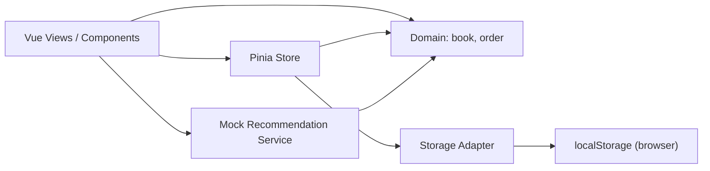
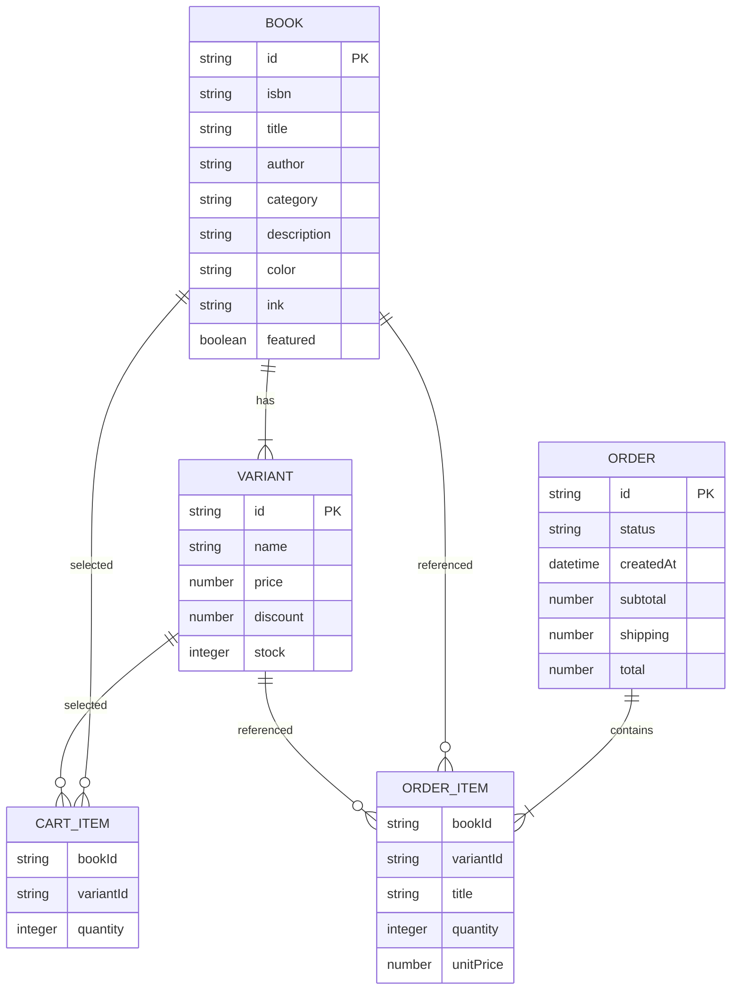
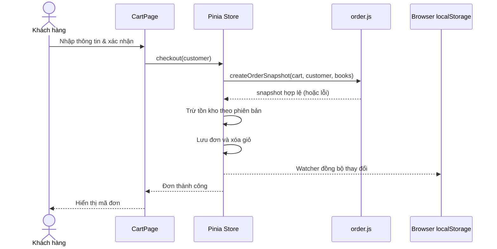
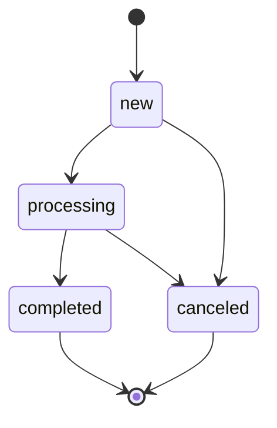

# Kiến trúc hệ thống — BookFlow

## 1. Sơ đồ thành phần (Clean-style frontend / phân tách trách nhiệm)

**Hướng phụ thuộc:** UI phụ thuộc domain; store điều phối use case; domain là các hàm JavaScript thuần không biết về Vue, localStorage hay UI. `storage.js` là adapter lưu trữ thay thế được. Không có network API. Không có backend.

## 2. Mô hình dữ liệu logic

Mã `variantId` chỉ duy nhất *trong phạm vi sách*, khóa ghép nghiệp vụ là `(bookId, variantId)`.

## 3. Luồng đặt hàng — tracer bullet (vertical slice)

**Quy tắc:** không trừ kho khi thêm vào giỏ; kiểm tra lại trước khi tạo đơn; hủy chỉ từ `new` / `processing` và hoàn kho đúng một lần. Việc cập nhật là nhất quán trong *một tab trình duyệt* nhưng không có transaction đa thiết bị.

## 4. Quy trình / trạng thái đơn

## 5. DDD mức frontend (lightweight)

- **Bounded context Catalog:** `Book`, `Variant`, ISBN, giá, giảm giá, phân loại.
- **Bounded context Inventory:** tồn kho và thao tác điều chỉnh kho.
- **Bounded context Sales:** `CartItem`, `Order`, `OrderItem` snapshot, state machine, khách hàng.
- **Infrastructure:** adapter lưu trữ và chatbot mô phỏng; không gắn vào domain.

## 6. SOLID và thiết kế để thay đổi

- **SRP:** các hàm tính giá/tồn kho ở `domain/book.js`; đặt hàng và trạng thái ở `domain/order.js`; giao diện chia thành views/components.
- **OCP / DIP phù hợp phạm vi frontend:** dữ liệu có thể chuyển từ storage adapter sang IndexedDB hoặc HTTP API mà không viết lại các công thức domain. Store hiện import adapter trực tiếp, do đó DIP mới được áp dụng một phần chứ chưa là inversion hoàn chỉnh.
- **ISP:** mỗi component chỉ nhận props / emits cần dùng.
- **Composition:** tách `BookCover`, `BookCard`, `BookEditor`, `ChatAssistant` thay vì component khổng lồ.
- **Patterns sử dụng:** Repository-like Storage Adapter, reactive Store (Observer), Factory (`freshBooks`, `initialDatabase`), Strategy-like pure selection (`searchBooks`, `mockBookAdvice`). Không nhận là Design Pattern chính thức nếu chưa có abstraction tương ứng.

## 7. Nâng cấp được trong tương lai

Có thể bổ sung role-based auth, PostgreSQL/backend, thanh toán, kho đa chi nhánh, barcode, gửi email, API AI thật **sau khi** thiết kế bảo mật phía server. Không chèn API key thật vào `VITE_*`/client.
